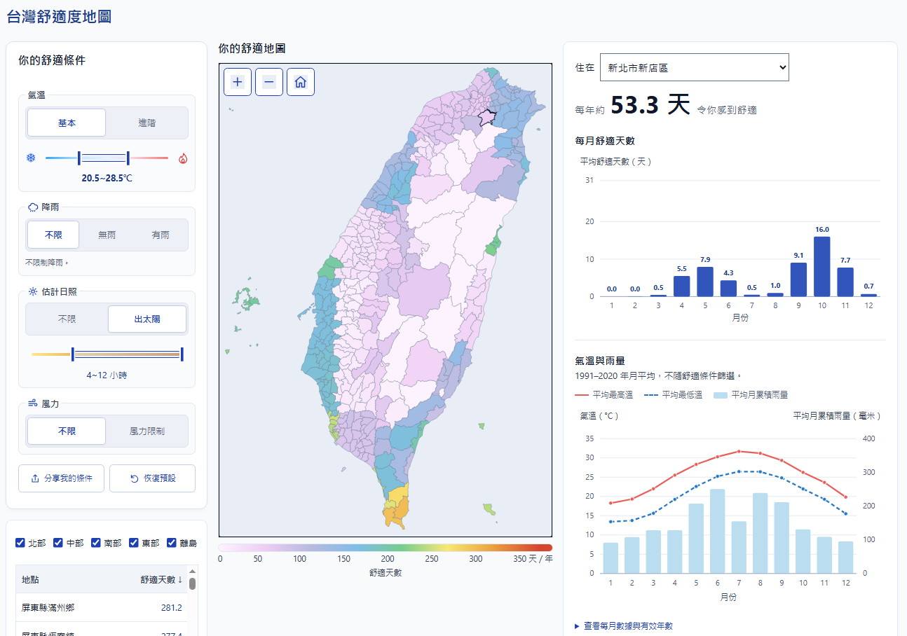

# 台灣舒適度地圖

[線上使用：台灣舒適度地圖](https://comfort.papple23g.com/)

依自訂氣溫、降雨、估計日照與風速條件，比較台灣各鄉鎮平均每年符合條件的天數。結果為 **1991–2020 年歷年平均估算，非即時觀測或天氣預報**；各鄉鎮以代表點估算，資料來源與方法見網站頁尾。

「分享我的條件」提供條件連結與 PNG 結果圖片，可複製連結、預覽及下載圖片；瀏覽器支援時也可使用系統分享。一般瀏覽不保存篩選設定。



## 建置、預覽與部署

需要 Node.js 22 或更新版本；以下本機預覽指令另需 Python 3：

```powershell
node build_site.cjs
python -m http.server 8766 --bind 127.0.0.1 --directory dist
```

開啟 [本機預覽](http://127.0.0.1:8766/)，以 Ctrl+C 停止伺服器。

網站使用 Cloudflare Workers Static Assets，設定見 `wrangler.jsonc`。以具 `papple23g.com` 網域權限的帳號登入 Wrangler 後，執行：

```powershell
node build_site.cjs
npm exec --yes --package=wrangler -- wrangler deploy
```

每次建置會清除並重新產生 `dist`，不改動 `data` 原始檔。部署僅上傳 `dist`，並保留其中的 `_headers`。`.gz` 須以 `application/gzip` 原樣提供，不得設定 `Content-Encoding: gzip`，以免重複解壓；本機 Python 伺服器不會套用 `_headers`。

流量與網頁效能：至 Cloudflare Web Analytics 選擇 `comfort.papple23g.com` 查看。

## 驗證

```powershell
node --test test_frontend.cjs test_prelaunch.cjs
python -m pytest -q -p no:cacheprovider
```

資料測試只使用本機資料，不會重新下載氣候資料；通過測試不代表氣象估算準確度已驗證。
