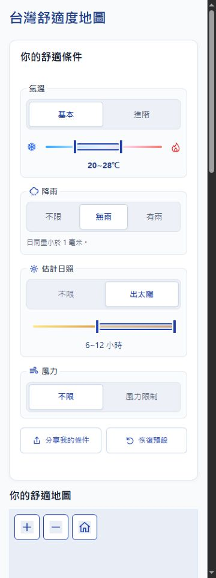

# 滑桿放開後的結果更新效能

範圍：縮短四種滑桿放開後的完整精確計算，保留既有未提交修改、資料與篩選規則。本機驗證，不部署。

| 工作 | 狀態 | 驗證 |
|---|---|---|
| 計算核心與快取 | completed | 位元切片索引約 16.16MB；背景每批最多約 16ms、主執行緒約 4ms 讓出；後續背景查詢 9.2～39.2ms |
| 放開事件與畫面更新審查 | completed | 唯讀 reviewer 確認放開直接計算，不等待 160ms；六項相關既有測試通過，未發現另一處秒級延遲 |
| 正確性、取消、資料與建置檢查 | completed | 80 項測試通過；四份原始資料 Git 物件雜湊與 HEAD 相同；獨立 reviewer 的 780 組隨機差分通過 |
| 瀏覽器時間量測 | completed | 桌面及 375px Chrome 實際滑鼠放開到 DOM 更新完成為 26～119.2ms；Android Threads 實機未測 |

協作範圍：主 agent 修改計算模組與測試；reviewer 唯讀前端事件、畫面更新與排程，結果由主 agent 整合。原始逐日演算法作為獨立基準，年度及每月結果必須完全相同，取消及過期結果不得回寫。

## 計算量測

同一台 Windows、同一份完整資料，使用 Node Worker 依序更改氣溫、日照、降雨及風力。第一項包含初始化，後六項重用索引。原始及新模組皆在本機測量；不是 Android 裝置的結果。

| 條件 | 原始背景核心 | 新背景核心 | 無 Worker 的分段備援 |
|---|---:|---:|---:|
| 首次載入及計算 | 1,662.0ms | 316.1ms | 676.6ms |
| 氣溫下限 21°C | 1,451.1ms | 18.1ms | 47.0ms |
| 氣溫下限 22°C | 1,718.8ms | 15.9ms | 36.1ms |
| 日照下限 5 小時 | 1,469.9ms | 18.8ms | 56.2ms |
| 降雨不限 | 1,497.4ms | 9.2ms | 80.1ms |
| 啟用風力限制 | 1,564.6ms | 18.7ms | 44.1ms |
| 有雨 | 1,415.6ms | 39.2ms | 79.2ms |

完整記錄：[計算基準](release-compute-benchmark.json)、[瀏覽器互動記錄](release-browser-benchmark.json)。數字為單次各情境觀察值，不是分位數或效能保證。

## 畫面更新與正確性

Chrome 1440px：兩次氣溫端點 119.2／97.2ms，日照 78.4ms，風力 115.3ms。Chrome 375px：氣溫 95.1ms、雨量 26.0ms。時間由獨立測試外框在 pointerup 捕獲階段開始，觀察應用計算狀態清空；MutationObserver 在同輪地圖、排名與圖表 DOM 更新後讀取時間。額外記錄的兩次 requestAnimationFrame 時間會受自動操作及分頁排程影響；其中一次模式切換為 1,142.3ms，不視為實際螢幕呈現時間的證明。

索引依原始編碼逐位建立，非近似資料；任意進階小數沿用原始解碼後的比較，避免小數邊界被反向編碼誤差捨入。每欄快取只保存最近一個有效區間，雨量依補充資料身份失效。索引、區間及雨量快取完成才提交；過期請求及取消仍不能覆寫最新結果。

- 新測試涵蓋全部 256 種編碼、31／32／33／65／517 天、跨 cell 與月份、缺值、任意小數、極端氣溫、雨量模式、資料重載與結果陣列隔離。
- `node --test test_frontend.cjs test_compute.cjs test_prelaunch.cjs`：80／80 通過，約 26.3 秒。
- 另一名 reviewer 唯讀檢查位元比較、缺值、padding、月份、取消、快取與 Worker 備援，執行 780 組隨機差分，無必要修正發現；兩位 reviewer 均已收束。
- JavaScript 語法、`git diff --check` 及建置測試通過。README 已依 `artifact-hygiene` 更新索引與記憶體說明；原先事件與手勢描述仍有效。

首次載入需建立索引；若尚未完成就更改條件而取消，下一個請求會重建。這項冷啟動成本與首次計算完成後的滑桿更新不同。16.16MB 為索引本身，不含原始資料、區間快取及頁面記憶體。尚未取得 Android Threads、Android Chrome、Samsung Internet、Firefox 或 Safari 的實機量測；375px 為桌面 Chrome 尺寸模擬與滑鼠操作。

內網測試：<http://192.168.1.107:8765/>。未提交、推送或部署正式站。

