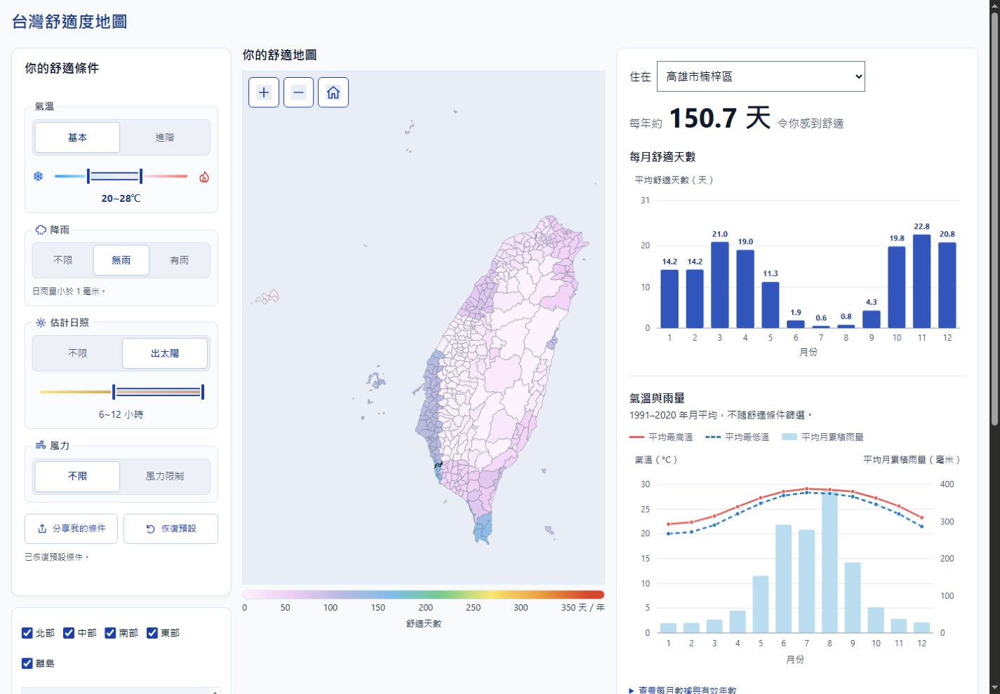
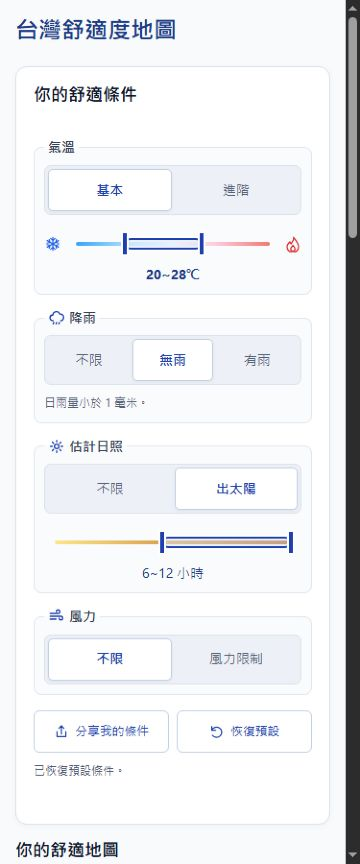

# Android 內嵌瀏覽器滑桿與背景計算改善

範圍：讓四種雙滑桿在拖曳時即時更新讀值，將氣候計算移至背景、只套用最新結果，改善手機命中區與手勢一致性。保留資料與篩選規則。

| 任務 | 狀態 | 負責範圍 | 完成證據 |
|---|---|---|---|
| 背景計算與取消過期工作 | complete | 背景計算 worker：`climate-compute.js`、`test_compute.cjs` | 9 項通過；真實資料的 Node Worker、分段計算與原規則逐項一致 |
| 滑桿互動與前端整合 | complete | 主 agent：`index.html`、`test_frontend.cjs` | 40 項通過；四種端點、整段拖曳、命中區、模式記憶與無位移放開後續算 |
| 建置與整合測試 | complete | 建置測試 worker：`build_site.cjs`、`test_prelaunch.cjs`；主 agent 補入審查回歸 | 29 項通過；版本化資產、初始化、分享、重試、過期結果及重設競態 |
| 瀏覽器與成品檢查 | complete | 主 agent：Chrome；獨立 reviewer：限定範圍唯讀審查 | 1440／1240／800／543×357／375px 均無整頁溢位；滑鼠與鍵盤操作、畫面與殘留文字檢查完成；實機限制如下 |

驗收：數值與規則保持一致；拖曳不在主執行緒執行完整氣候掃描；過期結果不可覆蓋最新條件；Worker 不可用時仍可操作；窄區間可拆開、整段平移保持寬度；頁面可正常捲動。最後執行一次範圍內審查，最多三輪修正已確認問題。

資料基線：368 個代表點、每點 10,958 天，共 4,032,544 次逐日檢查。原本拖曳停止 40ms 後於主執行緒同步執行計算與畫面更新。正式站的滑桿控制器與本機一致；修改前 `test_frontend.cjs` 38 項通過。

實機限制：使用者回報 Android Threads 內嵌瀏覽器卡頓、Chrome 正常。目前尚未取得該內嵌瀏覽器的實機效能追蹤，不把模擬結果當成實機驗收。

## 完成結果與證據

四種滑桿拖曳期間只更新把手、色段、數值及無障礙讀值；放開後才提交完整計算。端點統一使用 Pointer Events 與 capture，操作盒為 44×44px，保留原來滑軌的中心公式。整段拖曳排除兩端各 22px，窄區間仍可用端點或 Shift 鍵調整。

計算模組只初始化一次，最多保留一個執行中請求與最新待算請求。前端以請求編號及有效條件隔離過期結果；同條件的鄉鎮切換與分享共用進行中運算。Worker 建立、通訊或逾時失敗時，使用同一判定核心分段計算，不退回整段同步掃描。

獨立審查找到三個非同步問題：拖曳計時器到期後無位移放開可能漏算、重設可能使等待中的分享視窗重新開啟、計算期間切換鄉鎮可能保留舊圖與黑框。三項均已修正並加入回歸測試。

- `node --test test_frontend.cjs test_compute.cjs test_prelaunch.cjs`：78／78 通過，約 62.6 秒。
- 五個 JavaScript 檔案 `node --check` 及頁面 inline script 的 VM 語法檢查通過。
- `data/climate.bin`、`meta.json`、`towns.geojson`、`weather-details.json` 的 Git 物件雜湊與修改前 HEAD 相同。
- 三組完整歷年年／月結果的固定 SHA-256 均維持原值；建置資料版本仍為 `73651d913cb34358`。
- 建置包含內容雜湊版的計算模組，主頁及 Worker 路徑一致；原始氣候資料、gzip 解壓與 cache headers 的測試通過，報告與測試不發布。
- 桌機 Node 的分段計算量測約 1,098ms，76 段中最大 4.17ms、P95 4.12ms；這不是 Android／Threads 的效能測量。
- Chrome 實際滑鼠操作確認：氣溫端點外圍命中、整段移動、Shift＋Home，及雨量／日照／風力端點均可操作；端點無 focus 框，基本與進階設定仍獨立。
- `artifact-hygiene`：已替換失效的「只有重疊端點走自訂拖曳」註解，README 與測試指令符合目前行為；UI 僅顯示對使用者有用的更新狀態。
- `git diff --check` 通過；未執行 Git 提交或推送。

驗證分界：Chrome 桌面及其尺寸覆寫已實測；touch／pen 的方向、取消、範圍與命中規則是事件測試。Android Threads 實機、Android Chrome 實機、Samsung Internet、Firefox、Safari 尚未實測；不能據此宣稱正式站 INP 已改善。

發布狀態：目前為本機建置與驗證完成；尚未將本次修改部署至正式站。
